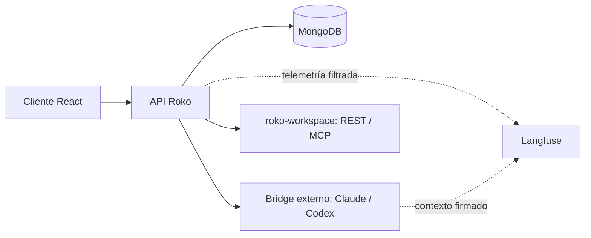

# Especificación actual de Roko

Estado del código revisado el 20 de octubre de 2026. Esta especificación describe
el repositorio; no certifica la versión instalada en servidores externos.

## Arquitectura

Roko conserva el monorepo LibreChat: `api/` sirve Express y sus rutas existentes;
`packages/api` aporta lógica TypeScript; `packages/data-provider` comparte contratos;
`packages/data-schemas` define persistencia MongoDB; `client/` y `packages/client`
contienen aplicación y componentes React. El paquete raíz declara `v0.8.6`.

El Compose base también define Meilisearch, vectordb y rag_api. Redis se configura
aparte cuando se necesita coordinación entre instancias. El pipeline de este
repositorio despliega el servicio `api`; Bridge y roko-workspace se operan por separado.

## Identidad y registro

Cada usuario tiene un correo normalizado a minúsculas. El índice de usuarios es
único para **`email + tenantId`**: impide duplicados dentro del mismo tenant, permite
varios usuarios con distintos correos y no impone unicidad global entre tenants.

El registro comprueba el usuario existente y las colisiones del índice. Una
colisión devuelve HTTP 409 con código `EMAIL_ALREADY_EXISTS`; el cliente muestra
el error localizado. Este cambio no fusiona ni repara automáticamente datos
duplicados de instalaciones anteriores.

Fuentes: [esquema de usuario](packages/data-schemas/src/schema/user.ts) y
[AuthService](api/server/services/AuthService.js).

## Workspace MCP y transferencia de archivos

Roko conecta el MCP estático `roko-workspace` para modelos que no tienen el
workspace integrado en Bridge. La preferencia `personalization.workspace` es
global por usuario, queda habilitada cuando no está definida y permite optar
por deshabilitarlo. Los alias `claude-max*` y `gpt-codex*` se excluyen. Si no
se configuran `ROKO_WORKSPACE_URL` y `ROKO_WORKSPACE_KEY`, no se conecta.

La URL base por defecto es `http://roko-workspace:8080` y resuelve al servicio
en la red Docker interna compartida por el API de Roko y `roko-workspace`;
Bridge no necesita acceso a esa red y el puerto del servicio no se publica en el
host. MCP usa `/mcp`, Bearer estático, timeout de 180 s e instrucciones estáticas.
No hace llamadas REST al generar instrucciones.

La conexión MCP se puede compartir entre conversaciones del mismo usuario. El
transporte agrega en cada petición HTTP la identidad obtenida del
`AsyncLocalStorage` de esa invocación; no la guarda en la configuración cacheada
ni usa `setRequestHeaders` por llamada. Cada firma incluye tenant, usuario,
conversación, timestamp actual, versión 1, audiencia `roko-workspace` y los
seudónimos de telemetría disponibles. Las cabeceras falsas `x-roko-*` se eliminan
y solo se firman destinos que coinciden con el origen y prefijo configurados. Si
falta contexto no se inventa una conversación: la petición queda sin firma. El
servicio es stateless y no requiere `mcp-session-id` ni SSE.

`attach_chat_file(file_id)` transfiere solo un adjunto del mensaje actual a
`inputs/`; Roko nunca sube todos los adjuntos automáticamente. El cliente REST
limita las entradas a 100 MiB. `deliver_workspace_file(path)` pide al servicio una
salida de `outputs/` ya validada (máximo 15 MiB) y Roko guarda el buffer como un
archivo y artefacto del chat. Las herramientas no aceptan identificadores de
workspace, por lo que el modelo no puede cambiar de ámbito.

Al eliminar una conversación Roko solicita borrar su workspace. Los fallos se
registran sin cancelar el borrado; el TTL del servicio cubre expiraciones por
otros caminos. Los metadatos históricos de adjuntos con contexto `filestore`
siguen teniendo lectura para mostrar chats antiguos.

## Nextcloud e inicio de sesión

La integración de Nextcloud es independiente del workspace. Con `NEXTCLOUD_URL`
configurado, Roko utiliza Login Flow v2 y WebDAV bajo la raíz del UID canónico
del usuario. Las credenciales de aplicación se cifran en MongoDB; ninguna
credencial compartida sustituye a la cuenta personal. Consultas, vinculaciones
y propuestas se filtran explícitamente por propietario y tenant.

El login con Nextcloud puede provisionar una cuenta USER sin registro separado.
Una identidad previamente vinculada abre la cuenta Roko existente; no se fusionan
usuarios por coincidencia de email. Las cuentas nuevas usan un email técnico
determinista `@nextcloud.invalid`. Las vinculaciones de identidad son únicas
por servidor + UID + tenant y se conservan al revocar el acceso a archivos.
El flujo anónimo está ligado a un nonce HttpOnly del navegador y al tenant.
La verificación adicional de Roko se mantiene al emitir su sesión.

`nextcloud_files` ofrece lectura y propuestas de escritura a los chats de
agentes. El panel reconoce colecciones DAV para navegar y adjunta archivos
individuales, incluidos tipos no reconocidos que se etiquetan como binarios
genéricos. La descarga desde Nextcloud admite hasta 100 MiB, sujeta además a
los límites de tamaño y tipo del endpoint/modelo. `/backups` y sus descendientes
permiten leer y adjuntar, pero rechazan escrituras tanto al proponer como al
ejecutar una propuesta. Las escrituras restantes se limitan a 8 MiB para caber
en el documento cifrado de MongoDB. Una propuesta guarda la revisión de la
cuenta, caduca y se consume atómicamente una sola vez. Las copias no sobrescriben
y los reemplazos exigen un ETag fuerte. El modelo no puede aprobar mediante sus
herramientas. No hay sincronización automática entre copias del chat, Nextcloud
y el workspace.

`PERSISTENT_SESSIONS=true`, activado en el override Docker, conserva sesiones
locales/Nextcloud sin caducidad práctica por inactividad (fecha del año 9999),
manteniendo acceso JWT corto y revocación de sesiones. Las cookies siguen
sujetas a los límites del navegador y OIDC externo mantiene sus propias reglas.
Configuración, límites y rutas de uso: [NEXTCLOUD.md](NEXTCLOUD.md).

## Modelos y Bridge

El endpoint personalizado Claude Max usa los alias `claude-max`, `claude-max-fast`
y `claude-max-deep`. El endpoint ChatGPT Codex (`gpt-codex*`) vuelve a estar configurado sobre el mismo Bridge. Los valores efectivos se incluyen en
el contexto firmado. Véase [CLI-BRIDGE.md](CLI-BRIDGE.md).

Google (Gemini API) es un endpoint nativo de LibreChat. Requiere `google` en
`ENDPOINTS` y `GOOGLE_KEY`; las model specs usan solo modelos del nivel gratuito.

El adaptador solo firma solicitudes a la URL fija configurada y rechaza
redirecciones. Firma usuario, tenant, conversación, modelo, opciones y tiempo.
Los controles de sampling y tokens no expuestos por los SDK se deshabilitan y se
retiran de configuraciones guardadas. Cambiar de proveedor elimina opciones
incompatibles. Al reenviar Responses se eliminan elementos opacos de reasoning,
conservando mensajes y pares de llamadas/resultados.

El código OAuth de `packages/api/src/endpoints/claude` sigue presente. Es una
integración distinta del endpoint personalizado Claude Max que usa Bridge.

### Memorias y herramientas del chat

`runtime-config.yaml` habilita memorias personales con actualización automática
mediante el proveedor `Claude Max`, modelo `claude-max-fast`. Las instrucciones
del agente aplican en el mismo turno lo que el usuario pida recordar, cambiar u
olvidar. La ejecución usa el relay de herramientas del Bridge. Se mantienen los
controles de personalización y la gestión manual de memorias.

El chat recibe la herramienta `skill_library` (listar, leer, crear, editar y
eliminar skills) cuando la interfaz de skills permite crear. Cada operación
ejecuta la misma cadena de middlewares que la API REST de skills
(`api/server/services/Skills/crud.js`): permisos de rol, ACL por skill y
validación son idénticos a la UI. Eliminar bloquea la herramienta hasta que el
usuario aprueba un popup (`SkillDeletionRequests`); rechazar, cerrar o no
responder en 120 s conserva la skill.

Los menús habilitan búsqueda web, búsqueda de archivos, ejecución de código,
artifacts, skills y gestión de MCP. Los parámetros readonly conservan su control
visible en gris, deshabilitado y sin un setter efectivo.

El botón Web Search y el parámetro de endpoints personalizados consultan el
mismo estado: `conversation.web_search` para los modelos del Bridge y
`ephemeralAgent.web_search` para otros proveedores personalizados, como LM Studio.
Claude Bridge usa la búsqueda nativa de Claude (WebSearch y WebFetch), sin
credenciales de Serper/Jina; WebFetch solo alcanza direcciones públicas. La
búsqueda mediante herramienta mantiene la comprobación de credenciales de LibreChat.

Compose proporciona un valor por defecto para `LMSTUDIO_BASE_URL` que conserva
la dirección anterior. `LIBRECHAT_CODE_BASEURL` permite conectar el sandbox
compatible con la librería de agentes; habilitar la capacidad de código no crea
ese servicio. El workspace Roko se configura en el backend desde
`ROKO_WORKSPACE_URL` y no se enumera como MCP seleccionable por conversación.

## Actividad de la respuesta

El cliente agrupa comentario de progreso, partes THINK y herramientas en
**Actividad de la respuesta**. El grupo se abre durante la generación, se pliega
al terminar y permite reapertura manual. Respuesta final, errores y adjuntos
descargables quedan visibles fuera del grupo. Las columnas de agentes mantienen
sus propios grupos.

Los registros Bridge V1 se interpretan únicamente para presentación: no habilitan
ejecución. Se conserva el orden del comentario intercalado y una sola tarjeta por
operación al recibir cambios de estado. Los códigos públicos reconocidos de
`bridgeActivityDescriptions.json` mantienen compatibilidad; un código desconocido
no adquiere significado por su etiqueta. La explicación breve puede aprovechar
descripciones y parámetros observados, sin atribuir acciones internas no emitidas
por el SDK. El resultado distingue errores y validación parcial o no disponible.

La interfaz actual muestra explicaciones concisas, sin un panel de argumentos,
comandos o rutas técnicas. Los datos del chat y la copia exportada a Langfuse son
canales separados: cambiar el modo de privacidad de trazas no controla lo que
renderiza el chat. Solo se muestran comentarios y resúmenes públicos del
proveedor, no razonamiento interno privado.

### Tiempos

Las herramientas muestran segundos, con decimales cuando procede. Un intervalo
positivo menor de una décima aparece como `<0,1 s`; la ausencia de un comienzo
fiable no se convierte en una ejecución ficticia de cero segundos. La procedencia
puede ser tiempo de ejecución, tiempo del proveedor o intervalo observado entre
eventos; no todos representan tiempo de CPU ni duración completa del comando.

El encabezado comparte el contador general de generación: incluye la espera
anterior al primer evento y se detiene al acabar el envío. Usa un reloj monotónico
durante el montaje. Ese total **no se persiste**: al recargar una conversación
antigua no se inventa un total histórico. No se asigna un tiempo ficticio a cada
fragmento de pensamiento.

## Archivos generados y previsualización

Los archivos se persisten en el almacenamiento de Roko. Los enlaces Markdown se
resuelven contra los adjuntos de la respuesta actual y usan la descarga
autenticada del archivo correspondiente. Se conserva `metadata.originalFilename`
como basename público. Nombres ambiguos y enlaces externos no se redirigen a un
archivo supuesto; normalizar referencias sandbox no habilita traversal.

PDF, imágenes, texto y medios compatibles con el navegador pueden tener preview.
HTML sin convertir se muestra como texto. Office utiliza la conversión existente
y su ciclo pending/ready/failed mediante
[Files/preview.js](api/server/services/Files/preview.js); el HTML convertido se
aísla en un iframe sin scripts ni same-origin. El fallo de preview no elimina la
descarga. Los archivos antiguos sin conversión pueden necesitar regenerarse.

Las continuaciones recuperan la última salida de la rama actual, verificando
propietario y tenant, y la envían al nuevo workspace del Bridge. Un adjunto nuevo
explícito tiene prioridad. Una salida eliminada genera un error; no se sustituye
silenciosamente por una versión anterior.

## Telemetría y entrega

La raíz `roko.interaction` engloba el streaming. La exportación filtra una copia,
mantiene identidad seudonimizada de sesión y separa contabilidad Bridge y Roko.
La configuración, la propagación firmada y sus límites se documentan en
[OBSERVABILITY.md](OBSERVABILITY.md).

El Dockerfile aplica el parche de instrumentación, compila el frontend y hace
depender la imagen de producción de la etapa CI. GitHub Actions publica imágenes
identificadas por digest y despliega `api` mediante snapshots de configuración,
comprobación de salud y rollback. [CI-CLOUD.md](CI-CLOUD.md) describe ese contrato;
[TESTS.md](TESTS.md) distingue la selección CI del resto de suites disponibles.
